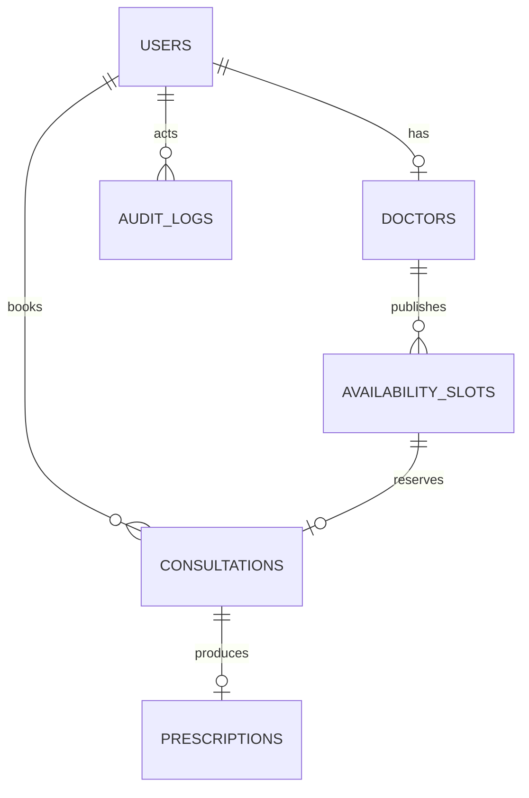

# Architecture

## Shape and data flow

Clients call the stateless API behind an ingress/load balancer. Authentication and authorization happen at the API boundary. PostgreSQL is the source of truth for users, doctors, slots, consultations, prescriptions, and audit events. Redis is reserved for rate limits, short-lived idempotency records, and cache entries. Heavy notifications, analytics aggregation, and payment reconciliation should be delivered through an outbox/worker tier.

The service is horizontally scalable because no request state is stored in process memory. PostgreSQL indexes cover email, doctor specialty, slot availability/time, and patient/doctor consultation timelines. At the target volume, partition consultations and audit logs by month and archive immutable audit partitions to object storage.

## Booking sequence

```mermaid
sequenceDiagram
  participant P as Patient
  participant API as API
  participant DB as PostgreSQL
  P->>API: POST /consultations + Idempotency-Key
  API->>API: Validate JWT, role, body
  API->>DB: BEGIN; SELECT slot FOR UPDATE
  DB-->>API: Available slot
  API->>DB: Mark booked + create consultation + audit
  API->>DB: COMMIT
  API-->>P: 201 consultation
```

The row lock and unique `slot_id` constraint make the operation safe under concurrent requests. A production idempotency table keyed by `(user_id, key)` should return the original response on retry.

## ER model



## Reliability and recovery

Use exponential backoff with jitter for transient database/queue/network errors, with bounded retries and a dead-letter queue. Transactions cover booking state and audit creation. Cross-service work uses an outbox and compensating actions rather than distributed transactions. PostgreSQL uses encrypted managed storage, daily full backups plus point-in-time recovery, multi-zone replicas, and quarterly restore drills. Target RPO is 5 minutes and RTO is 30 minutes.

